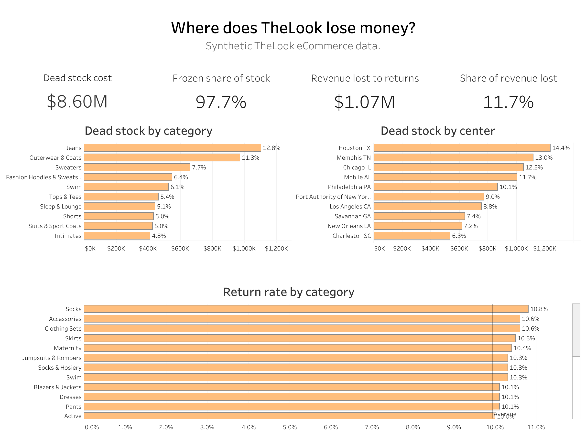

# Where does TheLook lose money?

SQL project on the TheLook eCommerce dataset.
I looked for the two places where an online clothing shop loses money:
stock that does not sell and items that customers return.

**Tools:** BigQuery (SQL), Tableau Public
**Dashboard:** [View on Tableau Public](https://public.tableau.com/app/profile/kristina.pavliuk/viz/WheredoesTheLooklosemoney/Dashboard1)

## 1. Business problem
A shop can grow sales and still lose money.
Two common reasons are stock that never sells and returned orders.
The goal is to find how much money is lost and where to start.

## 2. Questions
1. How much money is frozen in dead stock?
2. In which categories and distribution centers is it?
3. How much revenue is lost to returns?
4. Do return rates differ between categories?
5. Can we trust this data?

## 3. Key results
- **$8.6M** is frozen in dead stock. This is 97.7% of all current stock.
- Jeans (12.8%), Outerwear & Coats (11.3%) and Sweaters (7.7%) hold the most dead stock.
- Houston, Memphis and Chicago hold about 40% of dead stock cost.
- Returns cost **$1.07M** in revenue (11.7% of gross revenue) and $0.55M in margin.
- Return rates are about 10% in every category.

## 4. Conclusion
Dead stock is a much bigger problem than returns: $8.6M against $1.07M.
A clearance or write-off review could start with the top 3 categories and centers.
Returns look the same everywhere, so there is no single category to fix first.

## 5. Can we trust this data?
TheLook is a synthetic dataset. I found several patterns that do not look real:
- some dates are in the future;
- every unit sells within 60 days or never sells;
- almost all current stock never sells;
- return rates are almost the same in every category;
- the data changes every day.

The numbers show patterns in this dataset, not real business facts.

## 6. Approach
- I copied the source tables on 2026-11-11, so the results can be reproduced.
- I built two views: one row per unit in stock and one row per sold item.
- Dead stock means unsold units older than 60 days, because no unit sells after 60 days.
- Frozen money is measured by cost, not by sale price.
- Cancelled items are excluded from revenue, because customers did not pay for them.

## 7. Files
- `sql/01_setup.sql`: snapshot, data checks and views
- `sql/02_analysis.sql`: all analysis queries with results
- `data/`: CSV files used in the dashboard

## 8. Next steps
- Repeat the analysis on real shop data.
- Check why some categories and centers hold more dead stock.
- Test if the small differences in return rates are significant.
